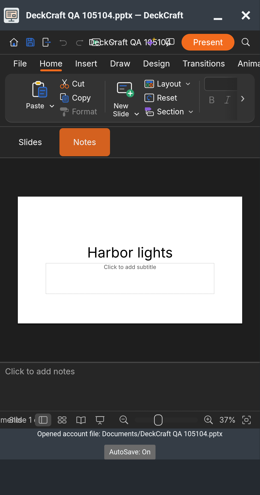
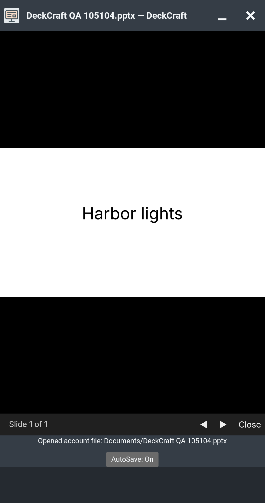

# DeckCraft on the Galaxy S10+

DeckCraft wrapper `cb717c1d` in viewer `07803e135d2f` uses the retained native Rust/WASM engine from `e8bb6a75`. The [WebOS integration guide](../../webos/INTEGRATION.md#portable-browser-build) gives the native build and packaging recipe. The viewer accepts the verified native package through `--deckcraft-site`.

1. In a signed-in session, open **Apps → Office → DeckCraft**. Tap the title box on the blank slide and enter **Harbor lights** with the Android keyboard.
2. Tap the disk icon. Cancel the first Save As and confirm the title remains. Save again and enter a name without an extension. The suggested format supplies `.pptx`.
3. Close the editor. In **Files → Documents**, select the presentation and choose **Open**. The editor shows the same text as an editable slide title.
4. Tap the book icon on the status bar for **Reading View**. The slide fills the center of the preview. Return to editing.
5. Open a local PPTX through **Import from this device**. The Android document picker opens the file, and the imported title remains editable.
6. Open **File → Print** and tap **Print** in the main panel. Enter a bare name to save a PDF copy in My files. The open document keeps its PPTX path.

Physical Galaxy S10+ Chrome 158.0.8127.92 used 411 CSS pixels in portrait and 480 CSS pixels of viewport height with the keyboard open. Chromium 158.0.8127.36 passed the PPTX file cycle at 820 and 1300 CSS pixels. The saved slide XML contains **Harbor lights** at all three widths and in the hosted guest replay. The save footer touches the editor, recovering 28 CSS pixels on the phone. All 41 adapter and packaging checks passed. The focused export regression test also verifies that a typed bare copy name receives the suggested PDF suffix.

The tested workflows cover six of ten areas on the phone. Slide authoring, cancel and retry, editable save and reopen, Reading View, native PPTX import, and PDF output through Print passed. The PDF action in **File → Export** sits beyond the right edge at 411 CSS pixels, and the narrow native title bar and status controls can overlap. Subsequent saves, multi-slide formatting and media, recovery, and the separate presenter-window flow still need device and desktop coverage for this release. On box-webhost, `/var/backups/webos-deckcraft-phone-presentation-07803e135d2f/deploy-viewer.py rollback` restores the preceding viewer.

